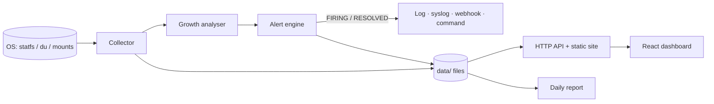

<div align="center">

# 🐈‍⬛ Black and White cats 🐈
### Linux Storage Monitoring System

Disk utilization · Inode usage · Storage growth · Administrator alerts · Daily reports · Live dashboard
**Linux · macOS · Windows** — one command, zero runtime dependencies

</div>

---

## Table of Contents
1. [Problem Statement](#1-problem-statement)
2. [Problem Understanding and Proposed Solution](#2-problem-understanding-and-proposed-solution)
3. [System Architecture / Design Diagram](#3-system-architecture--design-diagram)
4. [Implementation Approach and Major Linux Configurations](#4-implementation-approach-and-major-linux-configurations)
5. [Storage & LVM Configuration](#5-storage--lvm-configuration)
6. [Backup and Automation Approach](#6-backup-and-automation-approach)
7. [Security, Configuration and Validation](#7-security-configuration-and-validation)
8. [Expected Outcome](#8-expected-outcome)
9. [Conclusion and Future Scope](#9-conclusion-and-future-scope)
10. [Execution Commands (Linux · macOS · Windows)](#10-execution-commands-linux--macos--windows)
11. [Project Structure, API, Team and Credits](#11-project-structure-api-team-and-credits)

---

## 1. Problem Statement

Servers fail quietly when a disk or its inode table fills up. Administrators need a tool that **continuously watches disk space, inodes and growth, and warns them before the outage**, instead of discovering it afterwards.

---

## 2. Problem Understanding and Proposed Solution

### What goes wrong in practice

| Failure | Why it is easy to miss |
|---|---|
| **Disk full (100%)** | Databases, logs and package managers crash or corrupt data at the moment space runs out. |
| **Inode exhaustion** | `df -h` still shows free space, yet no new file can be created (millions of tiny files, mail queues, caches). |
| **Silent growth** | A log or backup growing 5 GB/day looks fine today and fatal in a week. A static percentage cannot show this. |
| **No history** | A one-off `df` says nothing about *when* or *how fast* the situation changed. |

### Proposed solution

A monitoring system made of **four cooperating parts**:

1. **Collector** — samples every mounted filesystem every 30 s: bytes total/used/free, inodes total/used/free, usage %.
2. **Growth analyser** — keeps up to 30 days of samples and fits a least-squares line over the last 24 h to produce *growth per day* and *days until full*.
3. **Alert engine** — compares every sample with thresholds and sends alerts **only on state change** (`FIRING` / `RESOLVED`), with hourly reminders for critical ones, so admins are informed, not spammed.
4. **Reports + live dashboard** — a daily text report for audit trails and a real-time web UI (landing page, dashboard, alerts, report, FAQ/team).

Every number on screen comes from the operating system at runtime — **nothing is simulated or hard-coded**.

| Requirement | How it is met |
|---|---|
| Disk utilization | `statfs` per mount, same source and formula as `df` |
| Inode usage | `files` / `ffree` from the same call (shown as `n/a` where the filesystem has no inode table, e.g. NTFS) |
| Storage growth | Linear regression of history, plus top-8 largest directories (`du` / built-in walker) |
| Administrator alerts | Log file, syslog, webhook, custom command (mail, notify-send, msg…) |
| Monitoring scripts | `server/monitor.mjs` (collector), `server/index.mjs` (service + API), `scripts/verify.mjs` |
| Reports | `reports/storage-report-YYYY-MM-DD.txt` + `/api/report` |

---

## 3. System Architecture / Design Diagram

```text
                           ┌──────────────────────────────────────────────┐
                           │              HOST OPERATING SYSTEM           │
                           │  /proc/mounts · mount · drive letters        │
                           │  statfs() · du · syslog(logger)              │
                           └───────────────────────┬──────────────────────┘
                                                   │ every 30 s
┌──────────────────────────────────────────────────▼─────────────────────────────────────────────┐
│                             NODE.JS PROCESS  (server/index.mjs)                                │
│                                                                                                │
│  ┌────────────────────┐   ┌────────────────────┐   ┌────────────────────┐   ┌───────────────┐  │
│  │ 1. COLLECTOR       │──▶│ 2. GROWTH ANALYSER │──▶│ 3. ALERT ENGINE    │──▶│ 4. REPORTER   │  │
│  │ mounts, bytes,     │   │ 24 h least-squares │   │ thresholds + state │   │ daily .txt    │  │
│  │ inodes, top dirs   │   │ days-to-full       │   │ FIRING / RESOLVED  │   │ on-demand API │  │
│  └─────────┬──────────┘   └─────────┬──────────┘   └─────────┬──────────┘   └───────┬───────┘  │
│            ▼                        ▼                        ▼                      ▼          │
│   ┌──────────────────────────  data/  &  reports/  (plain files)  ──────────────────────────┐ │
│   │ latest.json · history.jsonl (30 d) · topdirs.json · alert_state.json · alerts.jsonl/.log │ │
│   └───────────────────────────────────────────┬──────────────────────────────────────────────┘ │
│                                               │                                                │
│  ┌────────────────────────────────────────────▼───────────────────────────────────────────┐    │
│  │ HTTP SERVER (read-only GET)  /api/latest · /history · /alerts · /report · /team + dist/ │    │
│  └────────────────────────────────────────────┬───────────────────────────────────────────┘    │
└───────────────────────────────────────────────┼────────────────────────────────────────────────┘
                                                │ polls every 5 s
                         ┌──────────────────────▼───────────────────────┐        ┌───────────────────────┐
                         │ REACT + TAILWIND + SHADCN DASHBOARD          │        │ ALERT CHANNELS        │
                         │ Landing (crowd canvas) · Dashboard · Alerts  │        │ log file · syslog     │
                         │ Report · FAQ + Team tabs (GitHub)            │        │ webhook · command     │
                         └──────────────────────────────────────────────┘        └───────────▲───────────┘
                                                                                             │
                                                                      Alert engine ──────────┘
```



**Design decisions**

- **One process, no database** — plain JSON/JSONL files are easy to inspect, back up and grep.
- **Same data source as `df`** — so results can be verified against a tool every admin already trusts.
- **Atomic writes** (`write tmp → rename`) — the dashboard never reads a half-written file.
- **Slow work off the hot path** — the directory-size scan (`du`) runs in the background every 10 min and never delays sampling or startup.

---

## 4. Implementation Approach and Major Linux Configurations

### How each piece works

| Step | Linux implementation |
|---|---|
| Discover mounts | Parse `/proc/mounts`; skip pseudo filesystems (`proc`, `sysfs`, `cgroup`, `devpts`…), `tmpfs`, container internals; later mounts on the same path win, as in the kernel |
| Measure | `statfs()` → `used = (blocks − bfree) × bsize`, `avail = bavail × bsize`, `use% = used / (used + avail)` (identical to `df`) |
| Remove duplicates | Bind mounts of one device are collapsed using the device id (`st_dev`) |
| Inodes | `inodes_used = files − ffree`; filesystems reporting 0 inodes show `n/a` |
| Growth | Least-squares slope over the last 24 h; needs ≥ 3 samples spanning ≥ 60 s, otherwise the UI says *collecting* (never a made-up value) |
| Largest dirs | `nice -n 19 du -x -d 1 -k <mount>` (stays on one filesystem, lowest CPU priority) |
| Alerts | State machine per `mount:kind` key; syslog via `logger -p user.crit / user.warning` |

### Linux configurations an administrator should apply

| Area | Configuration |
|---|---|
| **Dedicated unprivileged user** | `sudo useradd -r -s /usr/sbin/nologin storagemon` — monitoring needs no root (statfs works for any user) |
| **Service management** | systemd unit (below) with `Restart=on-failure` |
| **Log rotation** | `/etc/logrotate.d/storage-monitor` for `data/alerts.log` (below) |
| **Syslog routing** | Alerts use tag `storage-monitor` → filter in rsyslog/journald: `journalctl -t storage-monitor` |
| **Thresholds** | `config/config.json` (80/90 % space, 80/90 % inodes, 14/3 days to full) |
| **Time sync** | Growth maths uses timestamps — keep `chrony`/`systemd-timesyncd` running |

**`/etc/systemd/system/storage-monitor.service`**

```ini
[Unit]
Description=Black and White cats - Linux Storage Monitoring System
After=network.target

[Service]
Type=simple
User=storagemon
WorkingDirectory=/opt/bwc
Environment=PORT=8080 HOST=127.0.0.1
ExecStart=/usr/bin/node server/index.mjs --no-open
Restart=on-failure
RestartSec=5
NoNewPrivileges=true
ProtectSystem=strict
ReadWritePaths=/opt/bwc/data /opt/bwc/reports

[Install]
WantedBy=multi-user.target
```

```bash
sudo systemctl daemon-reload && sudo systemctl enable --now storage-monitor
journalctl -u storage-monitor -f
```

**`/etc/logrotate.d/storage-monitor`**

```text
/opt/bwc/data/alerts.log {
    weekly
    rotate 8
    compress
    missingok
    notifempty
    copytruncate
}
```

---

## 5. Storage & LVM Configuration

The monitor does **not create** volumes; it **watches** whatever is mounted. Logical Volumes appear as ordinary filesystems (device `/dev/mapper/vg_data-lv_data`), so LVM-backed mounts are monitored with no extra setup. LVM is what makes the alert actionable: when growth predicts a full disk, the admin extends the volume **online**.

> ⚠️ The commands below are a **reference lab procedure** and are destructive on the disk you point them at. They were not executed as part of this project's automated tests. Use a spare disk or the loop-device variant.

### Safe lab setup (no spare disk needed — loop device)

```bash
sudo truncate -s 2G /var/lib/lab-disk.img
sudo losetup -f --show /var/lib/lab-disk.img          # prints e.g. /dev/loop5
sudo pvcreate /dev/loop5
sudo vgcreate vg_data /dev/loop5
sudo lvcreate -L 1G -n lv_data vg_data
sudo mkfs.ext4 /dev/vg_data/lv_data
sudo mkdir -p /data && sudo mount /dev/vg_data/lv_data /data
```

### Production layout (spare disk `/dev/sdb`)

```bash
sudo pvcreate /dev/sdb
sudo vgcreate vg_data /dev/sdb
sudo lvcreate -L 20G -n lv_data    vg_data
sudo lvcreate -L 10G -n lv_backup  vg_data
sudo mkfs.xfs  /dev/vg_data/lv_data
sudo mkfs.ext4 /dev/vg_data/lv_backup
sudo mkdir -p /data /backup

# persistent mounts by UUID (never by /dev name)
echo "UUID=$(sudo blkid -s UUID -o value /dev/vg_data/lv_data)   /data   xfs  defaults,nofail 0 2" | sudo tee -a /etc/fstab
echo "UUID=$(sudo blkid -s UUID -o value /dev/vg_data/lv_backup) /backup ext4 defaults,nofail 0 2" | sudo tee -a /etc/fstab
sudo mount -a && df -hT /data /backup
```

### Growing a volume when the monitor warns

```bash
sudo vgs && sudo lvs                                   # confirm free extents in the VG
sudo lvextend -r -L +5G /dev/vg_data/lv_data           # -r also grows the filesystem, online
# VG full? add a disk first:  sudo pvcreate /dev/sdc && sudo vgextend vg_data /dev/sdc
```

> `xfs` can only grow, never shrink. Use `ext4` where shrinking might be needed.

### Inode-aware formatting

Inode count is fixed at `mkfs` time on ext4. For volumes holding millions of small files:

```bash
sudo mkfs.ext4 -i 8192 /dev/vg_data/lv_small_files    # one inode per 8 KiB (default is 16 KiB)
```

### Capacity plan the monitor enforces

| Mount | Purpose | Warn / Critical (space) | Warn / Critical (inodes) |
|---|---|---|---|
| `/` | OS | 80 % / 90 % | 80 % / 90 % |
| `/data` (LV) | Application data | 80 % / 90 % | 80 % / 90 % |
| `/backup` (LV) | Backup target | 80 % / 90 % | 80 % / 90 % |
| any | Growth | full in ≤ 14 d / ≤ 3 d | — |

---

## 6. Backup and Automation Approach

Two layers: **(A) automation of the monitor itself** (ships with the project) and **(B) a backup routine that the monitor protects** (recommended procedure; the monitor checks its capacity, it does not run the backup).

### A. Automation shipped with the project

| Mechanism | What it does |
|---|---|
| Collector loop | Samples every `interval_seconds` automatically; self-heals after a bad cycle (errors are logged, loop continues) |
| Daily report | First sample of each day writes `reports/storage-report-YYYY-MM-DD.txt` |
| History pruning | Every 200 cycles history is compacted to `history_days` (30) |
| Alert de-duplication | One `FIRING`, one `RESOLVED`; critical reminders every `reminder_minutes` (60) |
| Exit codes | `npm run monitor` → **0** OK · **1** warning · **2** critical — directly usable by cron, Nagios, Zabbix, Task Scheduler |

### B. Backup routine (example)

```bash
# /usr/local/bin/nightly-backup.sh  (chmod 750, owned by root)
#!/usr/bin/env bash
set -euo pipefail
SRC=/data
DST=/backup/$(date +%F)
mkdir -p "$DST"

rsync -a --delete --link-dest=/backup/latest "$SRC"/ "$DST"/      # incremental via hard links
ln -sfn "$DST" /backup/latest

find /backup -maxdepth 1 -type d -name '20*' -mtime +14 -exec rm -rf {} +   # keep 14 days

# back up the monitor's own evidence too
tar -czf "$DST/bwc-config-and-reports.tgz" -C /opt/bwc config reports data/alerts.jsonl

# verify the backup target is still healthy; non-zero exit raises an alert path
cd /opt/bwc && npm run --silent monitor || logger -t nightly-backup "storage monitor reports warning/critical after backup"
```

**Schedule it**

```bash
# crontab -e   (root)
30 1 * * *  /usr/local/bin/nightly-backup.sh >> /var/log/nightly-backup.log 2>&1
*/15 * * * * cd /opt/bwc && npm run --silent monitor || /usr/local/bin/notify-admin.sh $?
```

**How the two layers work together**

```text
 01:30  nightly-backup.sh  ──▶  /backup grows (+N GB)
 every 30 s  monitor samples /backup ──▶ growth analyser: "/backup full in 6.2 days"
                                      ──▶ WARNING alert (≤ 14 d)  ──▶ syslog / webhook / mail
 admin: lvextend -r -L +10G /dev/vg_data/lv_backup     ──▶ RESOLVED alert automatically
```

**Alert → email example** (`config/config.json`)

```json
"command": { "enabled": true, "run": "echo \"$ALERT_STATE $ALERT_LEVEL: $ALERT_MESSAGE\" | mail -s \"Storage alert\" admin@example.com" }
```

Environment passed to the command: `ALERT_STATE`, `ALERT_LEVEL`, `ALERT_MOUNT`, `ALERT_MESSAGE`.

**Scheduling on other systems**

| OS | How to run at boot |
|---|---|
| Linux | systemd unit (section 4) |
| macOS | `launchd` plist running `node server/index.mjs --no-open` |
| Windows | Task Scheduler → "At startup" → `node server\index.mjs --no-open` |

---

## 7. Security, Configuration and Validation

### 🔒 Security

| Control | Detail |
|---|---|
| **Least privilege** | Needs no root; reads capacity through `statfs`. Run as a dedicated user. |
| **Local by default** | Binds to `127.0.0.1`. Remote access is an explicit opt-in (`HOST=0.0.0.0`). |
| **Read-only API** | The server answers `GET` only; nothing in the UI can change the system. |
| **No shell injection** | `du`, `logger`, `mount`, PowerShell are launched with `execFile` + argument arrays, never through a shell string. |
| **Path-traversal guard** | Static files are resolved and rejected unless inside `dist/`. |
| **No secrets in code** | Webhook URL and alert command live in `config/config.json` — restrict it: `chmod 640`. |
| **Hardened service** | systemd `NoNewPrivileges`, `ProtectSystem=strict`, write access only to `data/` and `reports/`. |
| **Crash-safe state** | Atomic file replacement prevents corrupted JSON. |

**Known limits (be aware):** there is **no login** — if exposed beyond localhost, place it behind a VPN or an authenticating reverse proxy (nginx basic-auth / OAuth proxy). The optional alert *command* is executed through the shell by design; only administrators should be able to edit `config/config.json`.

### ⚙️ Configuration (`config/config.json`)

| Key | Default | Meaning |
|---|---|---|
| `interval_seconds` | 30 | Sampling period |
| `warn_pct` / `crit_pct` | 80 / 90 | Space thresholds |
| `inode_warn_pct` / `inode_crit_pct` | 80 / 90 | Inode thresholds |
| `days_to_full_warn` / `_crit` | 14 / 3 | Growth-based alerts |
| `growth_window_hours` | 24 | Regression window |
| `min_samples` / `min_span_seconds` | 3 / 60 | Data needed before growth is reported |
| `history_days` | 30 | Retention |
| `du_every_seconds` | 600 | Largest-directory scan interval |
| `include_tmpfs` | false | Also monitor tmpfs |
| `exclude_mount_prefixes` | `/proc /sys /dev /run /snap …` | Mounts to ignore |
| `alerts.*` | log + syslog on | `webhook`, `command`, `reminder_minutes` |

Environment: `PORT` (default 8080), `HOST` (default 127.0.0.1). Team page data: `config/team.json`.

### ✅ Validation

| Check | How | Result observed (Linux test VM) |
|---|---|---|
| Accuracy vs `df` | `npm run verify` compares every mount (used/avail within 64 MiB tolerance) | `OK` on all filesystems; root matched to the byte |
| Growth detection | Wrote 300 MB then 700 MB with `dd` while running | Growth rate and days-to-full computed; critical growth alert fired |
| Space alert | Lowered `warn_pct`/`crit_pct` to 40/45 | `FIRING CRITICAL` written to `alerts.log`, API, exit code 2 |
| Resolve flow | Restored thresholds | Alert state cleared (`RESOLVED`) |
| Largest dirs | Compared against `du` | Top-8 list returned |
| Cross-platform parsing | macOS `mount` and Linux `/proc/mounts` sample parsers unit-checked | Correct (incl. paths with spaces) |
| Type safety / build | `tsc --noEmit` + `vite build` | Pass |

**Reproduce the tests yourself**

```bash
npm run verify                                  # accuracy vs df (Linux/macOS)
dd if=/dev/zero of=/tmp/growth.bin bs=1M count=1000    # force growth, watch the dashboard
npm run monitor; echo "exit=$?"                 # 0 ok / 1 warning / 2 critical

# inode-exhaustion drill on a tiny loop filesystem
truncate -s 64M /tmp/inode.img && mkfs.ext4 -N 2000 -q -F /tmp/inode.img
sudo mkdir -p /mnt/inode && sudo mount -o loop /tmp/inode.img /mnt/inode
sudo sh -c 'cd /mnt/inode && for i in $(seq 1 1900); do : > f$i; done'   # inodes → ~95 %, alert fires
sudo umount /mnt/inode
```

> Honest scope: automated testing was done on **Linux**. macOS discovery was verified against sample `mount` output and Windows relies on drive-letter probing; both run the same measurement code path, but treat first runs there as a check (`npm run verify` on macOS; compare with `Get-PSDrive` on Windows).

---

## 8. Expected Outcome

- Real-time, accurate view of **space, inodes, growth and top directories** for every mounted filesystem.
- **Early warning** (days ahead) instead of failure notification.
- Alerts that are **actionable and non-spammy** (`FIRING` / `RESOLVED`), delivered to logs, syslog, webhook or mail.
- A daily **report** for audit and a **dashboard** for at-a-glance status, working on Linux, macOS and Windows.

---

## 9. Conclusion and Future Scope

**Conclusion** — *Black and White cats* turns raw `statfs` numbers into early, trustworthy warnings. By combining utilization, inode monitoring and growth prediction with state-based alerting, it prevents the two classic storage outages (full disk and inode exhaustion) with a small, dependency-free, cross-platform tool.

**Future scope**

| Idea | Value |
|---|---|
| Built-in SMTP / Slack / Teams / Telegram senders | Remove the need for a custom command |
| Login + roles (OIDC / basic auth) | Safe remote access |
| LVM-aware view (`vgs`, `lvs`, free extents) and one-click extend suggestions | Close the loop between alert and fix |
| Backup job status (last run, size, age) on the dashboard | Verify backups, not just capacity |
| SMART / RAID health, per-user and per-directory quotas | Hardware and fairness monitoring |
| Multi-host agents with one central dashboard | Fleet monitoring |
| Prometheus / Grafana exporter, Docker image | Fit existing observability stacks |
| Seasonal / ML forecasting | Better predictions than a straight line |

---

## 10. Execution Commands (Linux · macOS · Windows)

**Requirement:** [Node.js](https://nodejs.org) **18.15 or newer** (`node -v`). Nothing else — no Python, no `npm install`.

### 🐧 Linux

```bash
unzip black-and-white-cats.zip && cd bwc
npm start                       # or: ./run.sh
# open http://127.0.0.1:8080
```

### 🍎 macOS

```bash
cd ~/Downloads && unzip black-and-white-cats.zip && cd bwc
npm start                       # or: ./run.sh   (or double-click run.command)
```

### 🪟 Windows

PowerShell:

```powershell
Expand-Archive black-and-white-cats.zip -DestinationPath . ; cd bwc
npm.cmd start                   # npm.cmd avoids the PowerShell script-policy error
```

Command Prompt: `cd bwc && npm start` — or just **double-click `run.bat`**.

### Common commands (all systems)

| Command | Purpose |
|---|---|
| `npm start` | Collector + API + dashboard in one process (opens the browser) |
| `npm run monitor` | One scan; exit code 0 / 1 / 2 (for cron / Task Scheduler) |
| `npm run report` | Print and save the full text report |
| `npm run verify` | Cross-check against the OS `df` (Linux/macOS) |
| `npm run dev` | Hot-reload development (needs `npm install` first) |
| `npm run build` | Rebuild the website into `dist/` |

**Change port / allow LAN access**

| Shell | Command |
|---|---|
| Linux / macOS | `PORT=8090 HOST=0.0.0.0 npm start` |
| PowerShell | `$env:PORT=8090; $env:HOST="0.0.0.0"; npm.cmd start` |
| cmd | `set PORT=8090 && set HOST=0.0.0.0 && npm start` |

**Troubleshooting**

| Symptom | Fix |
|---|---|
| `Missing script: "start"` / `ENOENT package.json` | You are in the wrong or an old folder — `cd` into the folder that contains `package.json` |
| `Port 8080 is busy` | Use another `PORT` (table above) |
| Landing page has no walking crowd | The sprite loads from the 21st.dev CDN; connect to the internet |
| Team tab shows no stats | GitHub API unreachable/rate-limited; links still work |

---

## 11. Project Structure, API, Team and Credits

```text
bwc/
├── server/
│   ├── monitor.mjs      # collector, growth, alerts, reports (cross-platform)
│   └── index.mjs        # launcher: collector loop + HTTP API + static site
├── scripts/
│   ├── verify.mjs       # compare with df
│   └── dev.mjs          # API + Vite together
├── config/
│   ├── config.json      # thresholds, interval, alert channels
│   └── team.json        # group members (GitHub links)
├── src/                 # React + TypeScript + Tailwind (shadcn structure)
│   ├── components/ui/   # button, feature-card, faqs-02, skiper39 (crowd canvas)
│   └── pages/           # landing, dashboard, alerts, report, faq
├── dist/                # prebuilt website
├── data/                # created at runtime (history, state, alerts)
├── reports/             # daily text reports
└── run.sh · run.command · run.bat
```

| Endpoint | Returns |
|---|---|
| `GET /api/latest` | Latest snapshot (filesystems, growth, alerts, summary) |
| `GET /api/history?hours=24` | Usage samples (≤ 300 points) |
| `GET /api/alerts?hours=168` | Active alerts + event history |
| `GET /api/report` | Current text report |
| `GET /api/team` | Group members |

**Tech stack:** Node.js (zero runtime deps) · React 18 · TypeScript · Tailwind CSS · shadcn-style components · Vite · GSAP

### Main Logic 
```
#!/usr/bin/env bash
WARN=80; CRIT=90; STATE=/var/tmp/storage.state; touch "$STATE"; rc=0

df -P | awk 'NR>1 && $1 ~ /^\/dev\//{print $6, $5}' | while read -r mp pct; do
  pct=${pct%\%}
  ipct=$(df -iP "$mp" | awk 'NR==2{gsub("%","",$5); print $5}')
  for kind in space:$pct inode:$ipct; do
    k=${kind%%:*}; v=${kind##*:}; [[ $v =~ ^[0-9]+$ ]] || continue
    level=ok; (( v >= WARN )) && level=warning; (( v >= CRIT )) && level=critical
    prev=$(grep "^$mp:$k " "$STATE" | cut -d' ' -f2)
    if [[ "$level" != "${prev:-ok}" ]]; then                       # alert only on state change
      logger -t storage-monitor -p user.${level/critical/crit} "$mp $k ${v}% -> $level"
      sed -i "\|^$mp:$k |d" "$STATE"; echo "$mp:$k $level" >> "$STATE"
    fi
  done
done
```

### 👥 Team

| Member | Role | GitHub |
|---|---|---|
| Shashank Patel | Linux System Administrator | [allenasat044-prog](https://github.com/allenasat044-prog) |
| Pankaj Pandurang Tike | Storage & Backup Administrator | [pankajt25](https://github.com/pankajt25) |
| Anmol Poddar | Automation and Security Engineer | [ANMOL16-IT](https://github.com/ANMOL16-IT) |
| Shikhar Srivastava | Testing, Documentation & Presentation Lead | [FFloverSHIKHAR2006](https://github.com/FFloverSHIKHAR2006) |

### Credits
Crowd-canvas landing: **Skiper UI** (attribution required, kept in source), illustrations by **openpeeps.com**, FAQ layout inspired by `faqs-02` on 21st.dev, UI primitives from **shadcn/ui** and **Radix**.
